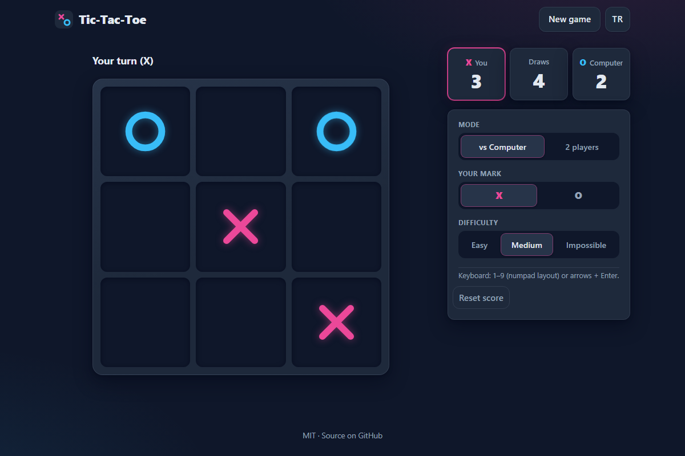

# Tic-Tac-Toe - the classic 3x3 game against an AI you cannot beat

[](#tests)
[](LICENSE)

**▶ Play now: https://celaldrg.github.io/tic-tac-toe/**



## Features

- **Three AI levels:** Easy (takes a win, otherwise plays at random), Medium (wins, blocks, then mixes perfect and random moves) and **Impossible**: a full minimax search with alpha-beta pruning that prefers faster wins and slower losses.
- **Proven unbeatable:** the test suite plays every possible game against the Impossible AI, as X and as O, and checks that it never loses.
- **Two-player mode** on one device.
- Pick your side (X or O); when you play O the computer opens.
- Animated marks (SVG stroke drawing) and an animated winning line.
- Scoreboard for X wins, O wins and draws, saved in your browser.
- English and Turkish, switchable at any time; your choice is remembered.
- Works on phones (touch) and desktops (keyboard), honours "reduce motion".
- No build step, no dependencies, no network requests: plain HTML, CSS and JavaScript modules.

## How to play

Get three of your marks in a row, column or diagonal before your opponent does.

| Action | Keyboard | Touch / mouse |
| --- | --- | --- |
| Place a mark | Digits **1-9** in numpad layout (7 8 9 = top row, 1 2 3 = bottom row) | Tap or click a cell |
| Move the cursor | **Arrow keys** | - |
| Place at the cursor | **Enter** or **Space** | - |
| Next round | **Enter** (focus jumps to the button when a round ends) | **Next round** button |

Use **New game** to restart the current round, the settings panel to change mode, side and difficulty, and **TR / EN** to switch the language.

## Run locally

Any static web server works. ES modules need `http://`; opening `index.html` as a `file://` URL will not work.

```sh
npx serve .
# then open the printed address, e.g. http://localhost:3000
```

Add `?demo` to the address to load the fixed mid-game position used for the screenshot.

## Tests

```sh
node --test
```

Node.js 20 or newer, no install step. The suite covers:

- **The AI never loses:** exhaustive search over every opponent move, with the AI trying every one of its optimal moves, both when it plays first and second; plus the same check through the game API that the UI uses.
- The AI takes an immediate win and blocks an immediate loss in every reachable position; faster wins and slower losses are preferred.
- Winner detection on all 8 lines for both marks, and draw detection.
- Game flow: turns, illegal moves, scoring, next round, score reset, the demo position.
- Keyboard mapping, seeded random numbers, storage helper (including a throwing storage), status texts, SVG geometry, and that English and Turkish define the same strings.

## Project structure

```
index.html          page markup, meta tags
style.css           dark theme, layout, animations
src/
  board.js          board helpers, winner and draw detection
  ai.js             minimax with alpha-beta, difficulty levels
  game.js           immutable game state: moves, rounds, score
  input.js          keyboard mapping (numpad digits, arrows)
  rng.js            seeded random number generator
  labels.js         which text describes the current state
  layout.js         SVG geometry for marks and the winning line
  i18n.js           English and Turkish strings
  storage.js        safe localStorage wrapper
  view.js           DOM rendering
  main.js           entry point: input, AI timing, persistence
test/               node:test suites
docs/screenshot.png
```

## License

[MIT](LICENSE) © 2026 Celalettin Durgaç

---

## Türkçe

Klasik 3x3 oyun: yenilmesi imkânsız bir yapay zekâya karşı Tic-Tac-Toe.

**▶ Hemen oyna: https://celaldrg.github.io/tic-tac-toe/**

### Özellikler

- **Üç zorluk seviyesi:** Kolay (kazanabiliyorsa kazanır, yoksa rastgele oynar), Orta (kazanır, engeller, sonra mükemmel ve rastgele hamleleri karıştırır) ve **İmkânsız**: daha hızlı galibiyeti ve daha geç mağlubiyeti tercih eden, alfa-beta budamalı tam minimax araması.
- **Yenilmezliği kanıtlı:** testler İmkânsız seviyeye karşı X ve O olarak olası her oyunu oynar ve hiç kaybetmediğini doğrular.
- Aynı cihazda **iki oyunculu mod**.
- Tarafını seç (X ya da O); O seçersen ilk hamleyi bilgisayar yapar.
- Animasyonlu işaretler (SVG çizgi animasyonu) ve animasyonlu kazanma çizgisi.
- X galibiyetleri, O galibiyetleri ve beraberlikler için tarayıcıda saklanan skor tablosu.
- İngilizce ve Türkçe; dil seçimin hatırlanır.
- Telefonda dokunmatik, masaüstünde klavye ile oynanır; "hareketi azalt" ayarına uyar.
- Derleme adımı, bağımlılık ve ağ isteği yok: sade HTML, CSS ve JavaScript modülleri.

### Nasıl oynanır

Rakibinden önce kendi işaretinden üçünü bir satır, sütun ya da çapraz üzerinde yan yana getir.

| İşlem | Klavye | Dokunmatik / fare |
| --- | --- | --- |
| İşaret koy | Sayı tuş takımı düzeninde **1-9** (7 8 9 = üst satır, 1 2 3 = alt satır) | Hücreye dokun ya da tıkla |
| İmleci taşı | **Ok tuşları** | - |
| İmlecin olduğu yere koy | **Enter** ya da **Boşluk** | - |
| Sonraki tur | **Enter** (tur bitince odak düğmeye geçer) | **Sonraki tur** düğmesi |

**Yeni oyun** mevcut turu yeniden başlatır; mod, taraf ve zorluk ayarlar panelinden değişir; **TR / EN** dili değiştirir.

### Yerelde çalıştırma

Herhangi bir statik web sunucusu yeterli. ES modülleri `http://` ister; `index.html` dosyasını `file://` ile açmak çalışmaz.

```sh
npx serve .
# sonra yazdırılan adresi aç, ör. http://localhost:3000
```

Ekran görüntüsündeki sabit oyun ortası konumu için adrese `?demo` ekle.

### Testler

```sh
node --test
```

Node.js 20 ya da üstü yeterli, kurulum gerekmez. Testler şunları kapsar:

- **Yapay zekâ hiç kaybetmez:** rakibin her hamlesini ve yapay zekânın her en iyi hamlesini deneyen kapsamlı arama, hem ilk hem ikinci oynarken; aynı kontrol arayüzün kullandığı oyun API'si üzerinden de yapılır.
- Ulaşılabilen her konumda yapay zekâ anında kazanır ve anında kaybı engeller; hızlı galibiyet ve geç mağlubiyet tercih edilir.
- Her iki işaret için 8 çizginin tamamında kazanan tespiti ve beraberlik tespiti.
- Oyun akışı: sıra, geçersiz hamleler, skor, sonraki tur, skor sıfırlama, demo konumu.
- Klavye eşlemesi, tohumlu rastgele sayılar, depolama yardımcısı (hata fırlatan depolama dahil), durum metinleri, SVG geometrisi ve İngilizce ile Türkçenin aynı metinleri tanımladığı.

### Lisans

[MIT](LICENSE) © 2026 Celalettin Durgaç
